<!-- Generated by `npx tsx scripts/catalog.ts` from engine/src/core/catalog.ts — edit that file, not this one. -->
<div dir="rtl">

# كتالوج المؤثرات · Effects catalog

كل مؤثر هنا تقدر تطلبه من Claude **بالاسم**، لأي جملة بالفيديو. ما تحتاج تكتب كود.

## شلون تختار؟

1. **اختار الستايل** — Claude يسألك قبل ما يبدأ: «أي ستايل تبي؟ ١ كريمي، ٢ داكن، ٣ ليزر، ٤ سويسري». إذا ما اخترت، يختار هو حسب السكربت.
2. **اختار الحركة** — ناعمة (easy) أو حادة (snappy).
3. **اختار لكل جملة** (اختياري) — اكتب الجملة واسم المؤثر، مثلاً:

```text
الجملة ٢ «هذا بس الخط»: شطب الكلمة على «الخط»
الجملة ٤: ليزر يقصّ العنوان
بين القسم ١ و٢: تمزيق ورق
الختام: بطاقة التوقيع
```

الجمل اللي ما تختار لها، Claude يصمّمها بنفسه. وتشوف صور الستوري بورد قبل أي رندر.

## الستايلات · Styles

| | الستايل | شنو هو | قول لـ Claude |
|---|---|---|---|
| 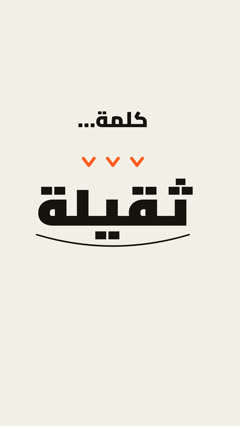 | **1. كريمي توقيع**<br>Signature cream | ورق كريمي، حبر أسود، كلمة بصندوق برتقالي؛ رسومات تبني نفسها | «خلّ الستايل كريمي» |
| 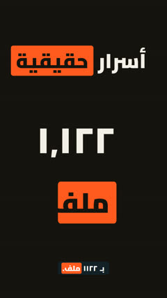 | **2. داكن تقني**<br>Dark tech | خلفية فحمية وكتابة فاتحة وبرتقالي؛ للشروحات التقنية | «خلّ الستايل داكن» |
| 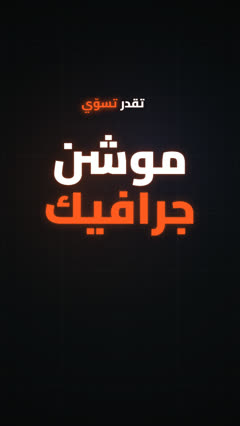 | **3. ليزر سينمائي**<br>Cinematic laser | شبكة داكنة، عنوان يتقصّ بالليزر، كلمات تتوهّج، ضربات على الإيقاع | «خلّ الستايل ليزر سينمائي» |
|  | **4. سويسري أحمر**<br>Swiss red | أبيض مطفي، أسود، وكلمة حمرة وحدة بكل سطر؛ نظيف ومسطّح | «خلّ الستايل سويسري أحمر» |

## حركات النص — Text animation

| | المؤثر | شنو يسوي | قول لـ Claude |
|---|---|---|---|
| 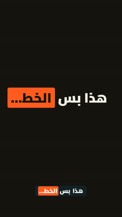 | **عنوان متحرك**<br><sub>`kinetic-text`</sub> | كلمات تدخل وحدة وحدة، وكلمة وحدة بصندوق ملوّن | «خلّ العنوان يطلع كلمة كلمة، و«…» بالصندوق» |
|  | **كلمة عملاقة**<br><sub>`kinetic-text:giant`</sub> | كلمة وحدة تملأ الشاشة | «خلّ كلمة «…» عملاقة بالنص» |
| 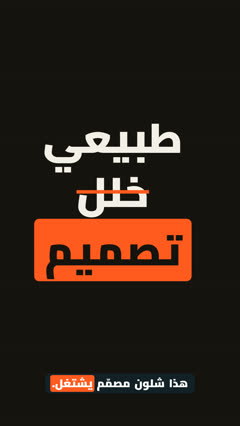 | **كلمات فوق بعض**<br><sub>`kinetic-text:stack`</sub> | كلمات تتراكم سطر تحت سطر | «رتّب «…» كلمات فوق بعض» |
| 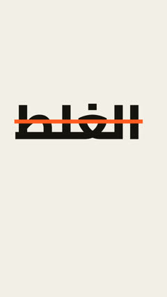 | **شطب الكلمة**<br><sub>`kinetic-text:strike`</sub> | خط يشطب كلمة غلط لحظة ما تقولها | «اشطب كلمة «…» لما أقول «…»» |
| 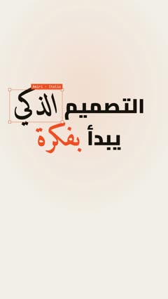 | **تحريري متحرك**<br><sub>`editorial-type`</sub> | خط عريض ويا خط مائل (أميري) بنفس العنوان، الكلمات تطلع من الضبابية، صندوق تحديد مثل برامج التصميم، وكلمة تتبدّل بكلمة | «سوّ العنوان تحريري، «…» بالخط المائل، وحدّدها وبدّلها بـ «…»» |
| 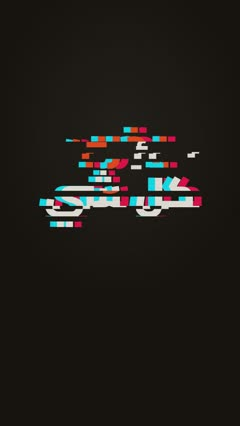 | **جلتش**<br><sub>`glitch-text`</sub> | العنوان يتشوّش ويدخل: نسخ حمرة وزرقة تنفصل وشرائح تزحلق، ضربات على الإيقاع، ويتشوّش لكلمات ثانية | «خلّ «…» يدخل بجلتش ويتحوّل لـ «…»» |
| 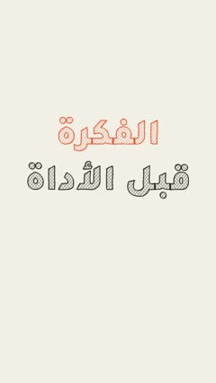 | **رسم بالقلم**<br><sub>`sketch-words`</sub> | الكلمات تنرسم بالرصاص: حدود الحروف تنخطّ وبعدين تظليل خطوط، والخط يرتجف مثل الرسم اليدوي | «ارسم «…» بالقلم الرصاص» |
| 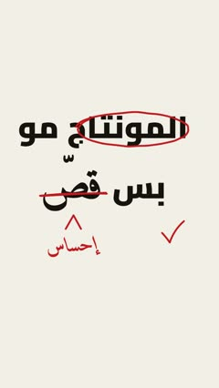 | **قلم المحرّر الأحمر**<br><sub>`red-pen`</sub> | قلم أحمر يشطب، يدوّر، يخطّ تحت، يحط ✓ و✗ وسهم، ويكتب ملاحظة بخط اليد | «اشطب «…» بالأحمر واكتب فوقها «…»» |
|  | **ضربة العنوان**<br><sub>`slam`</sub> | الكلمات تنضرب من كبير ومغبّش لمكانها | «خلّ العنوان ينضرب بقوة» |
| 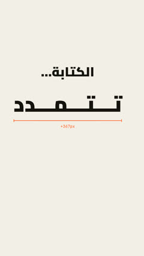 | **تمدّد الكشيدة**<br><sub>`type-stretch`</sub> | الكلمة تتمدّد بالكشيدة ويا مسطرة | «مدّد كلمة «…» بالكشيدة» |
| 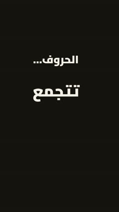 | **تجميع الحروف**<br><sub>`letters-join`</sub> | الحروف تطير وتتجمّع لكلمة متصلة | «خلّ حروف «…» تتجمّع» |
|  | **كلمة ثقيلة**<br><sub>`heavy-word`</sub> | كلمة تنزل وتثقّل الخط تحتها | «خلّ «…» كلمة ثقيلة» |
|  | **قلنا وكتبها**<br><sub>`said-written`</sub> | اللي انقال ضد اللي انكتب غلط | «وريني «قلنا … كتبها …»» |
|  | **قصّ على الكلمة**<br><sub>`word-cut`</sub> | تايم لاين مونتاج يقصّ على الكلمة | «سوّ قصّ مونتاج على كلمة «…»» |
| 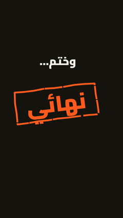 | **ختم**<br><sub>`stamp`</sub> | ختم مائل ينضرب على الشاشة | «اختم «…» على الشاشة» |
|  | **تعليم باليد**<br><sub>`highlight`</sub> | دائرة أو خط مرسوم باليد حول شي | «دوّر على «…» بخط اليد» |
|  | **جدار كلمة**<br><sub>`word-wall`</sub> | الكلمة تتكرر وتملأ الخلفية | «سوّ جدار من كلمة «…»» |
|  | **كشف بالمسح**<br><sub>`wipe-reveal`</sub> | العنوان ينكشف بمسحة من اليمين | «اكشف العنوان بمسحة» |
|  | **تكرار الصدى**<br><sub>`repeat-loop`</sub> | نسخ باهتة من الجملة تدور حولها | «كرّر الجملة كصدى حولها» |
|  | **رقم القسم**<br><sub>`section-number`</sub> | رقم كبير يطلع من تحت الشاشة | «حط رقم كبير لكل قسم» |
| 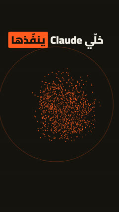 | **جزيئات تصير كلمة**<br><sub>`particle-word`</sub> | جزيئات تنفجر من شي وتتجمّع كلمة | «خلّ المصباح ينفجر جزيئات وتصير «…»» |

## حركات العنوان العربي — Arabic headline moves

| | المؤثر | شنو يسوي | قول لـ Claude |
|---|---|---|---|
| 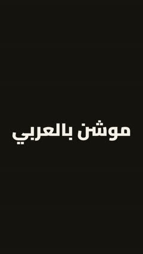 | **الحروف تتطابق**<br><sub>`arabic-move:letters-snap`</sub> | شرائح من السطر تطفو وبعدين تنطبق | «خلّ «…» تتطابق حروفها» |
| 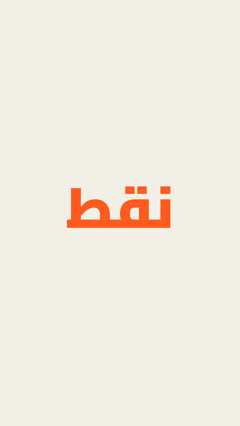 | **النقاط تنزل**<br><sub>`arabic-move:dots-drop`</sub> | نقاط الحروف تنزل بمكانها | «خلّ نقاط «…» تنزل» |
| 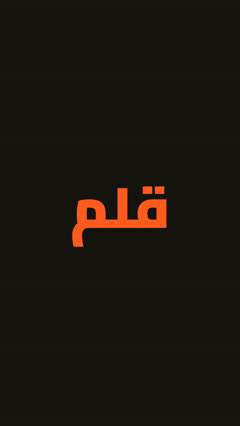 | **قلم يكتب**<br><sub>`arabic-move:pen-write`</sub> | قلم يكتب الكلمة جزء جزء | «خلّ القلم يكتب «…»» |
| 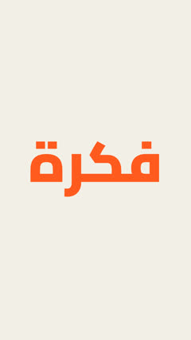 | **الكلمة تذوب**<br><sub>`arabic-move:word-melt`</sub> | كلمة تذوب وتصير كلمة ثانية | «ذوّب «…» وخلّها تصير «…»» |
| 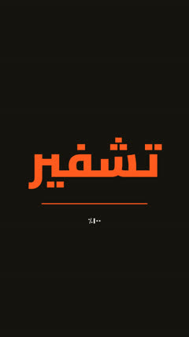 | **تشفير**<br><sub>`arabic-move:decrypt`</sub> | حروف عشوائية تستقر على الكلمة | «شفّر «…» وبعدين تنكشف» |
|  | **وضوح تدريجي**<br><sub>`arabic-move:unblur`</sub> | الكلمات تتوضح وحدة وحدة | «خلّ الجملة تتوضح كلمة كلمة» |
| 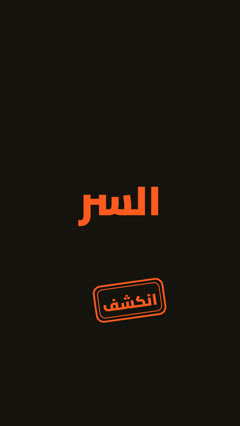 | **السر ينكشف**<br><sub>`arabic-move:redacted-stamp`</sub> | شرائط سودة تنشال وبعدين ختم | «خبّي «…» بشريط أسود وبعدين اكشفه» |
| 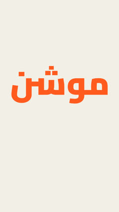 | **مربعات كوفي**<br><sub>`arabic-move:kufi-tiles`</sub> | مربعات تبني الكلمة على شبكة | «ابني «…» بمربعات كوفي» |
| 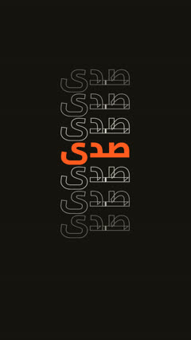 | **صدى**<br><sub>`arabic-move:echo-stack`</sub> | نسخ مفرّغة فوق وتحت الكلمة | «سوّ صدى لكلمة «…»» |

## ستايل الليزر — Laser (dark cinematic tech)

| | المؤثر | شنو يسوي | قول لـ Claude |
|---|---|---|---|
| 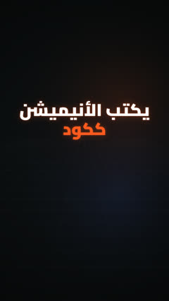 | **شبكة تقنية**<br><sub>`tech-grid`</sub> | خلفية داكنة بشبكة وتوهّج خفيف، أو أرضية منظور | «خلّ الستايل تقني ليزر» |
|  | **قصّ بالليزر**<br><sub>`laser-type`</sub> | ليزر يقصّ العنوان، الحافة حمرة وتبرد للأبيض، وشرار | «خلّ العنوان يتقصّ بالليزر» |
| 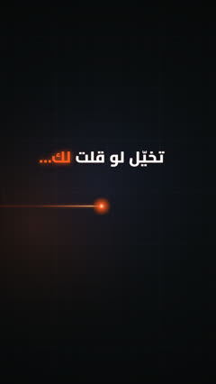 | **أشعة ليزر**<br><sub>`laser-beam`</sub> | شعاع ليزر، خطوط إرشاد، مخطط بصناديق وعلامة ✕ | «خلّ شعاع ليزر يمرّ، وارسم مخطط «…» ← «…»» |
| 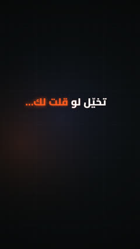 | **كلمات تتوهّج**<br><sub>`glow-words`</sub> | الجملة باهتة وكل كلمة تتوهّج لما تنقال | «خلّ الجملة تتوهّج كلمة كلمة» |
| 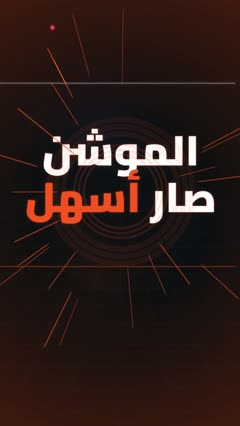 | **نبضة الإيقاع**<br><sub>`beat-pulse`</sub> | على كل ضربة: موجة دائرية، خطوط سرعة، وميض على الحواف، والكاميرا تنط ويا الضربة (`camera.pulses`) | «خلّ الفيديو ينبض ويا الإيقاع ١٢٠» |
| 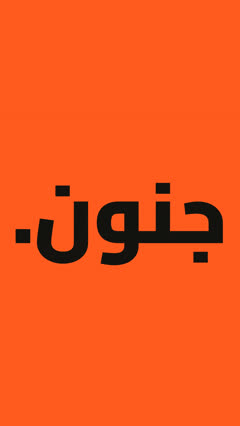 | **ضربات الإيقاع**<br><sub>`beat-slam`</sub> | على كل ضربة، الشاشة برتقالية وكلمة عملاقة | «سوّ ضربات «و · هذا · جنون» على الإيقاع» |

## مؤثرات على شخصك — Effects on you (needs a clip + mba matte)

| | المؤثر | شنو يسوي | قول لـ Claude |
|---|---|---|---|
|  | **قصّ الشخص**<br><sub>`cutout`</sub> | يقصّك من الفيديو بحواف احترافية؛ أي شي بمسار أوطى يصير وراك | «حط العنوان وراي» |
| 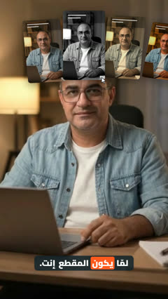 | **شبكة زوم**<br><sub>`cutout:grid`</sub> | كروت فيديو فوق راسك، يختار الأبيض والأسود ويدخل | «سوّ شبكة زوم فوق راسي» |
| 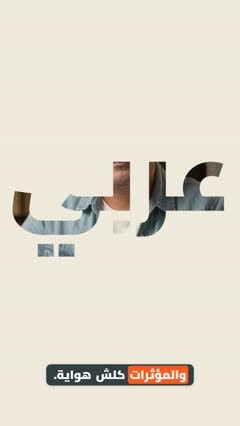 | **غوص بالحروف**<br><sub>`cutout:letters`</sub> | الفيديو داخل كلمة عملاقة والكاميرا تغوص | «خلّ الفيديو داخل كلمة «…» وغوص فيها» |
| 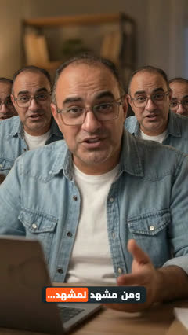 | **نسخ متكررة**<br><sub>`cutout:clones`</sub> | نسخ منك تطلع على الجانبين | «سوّ نسخ مني على الجانبين» |
| 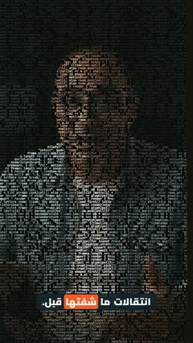 | **جسم من الكود**<br><sub>`cutout:code`</sub> | الشاشة كلها تصير كود وإنت بألوانك | «خلّني جسم من الكود» |
| 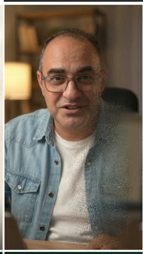 | **يتطاير**<br><sub>`cutout:dust`</sub> | تتطاير غبار والغرفة تبقى | «خلّني أتطاير» |
| 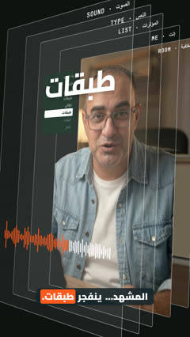 | **انفجار طبقات**<br><sub>`cutout:layers`</sub> | اللقطة تنفصل طبقات ثلاثية: الخلفية، إنت، النص، الصوت | «فجّر المشهد طبقات» |
| 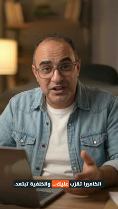 | **زوم دوللي**<br><sub>`cutout:dolly`</sub> | الخلفية تبتعد وإنت ثابت | «سوّ زوم دوللي» |
|  | **تركيز خلفي**<br><sub>`cutout:blur`</sub> | الغرفة تتغبّش وإنت واضح | «غبّش الخلفية وخلّني واضح» |
| 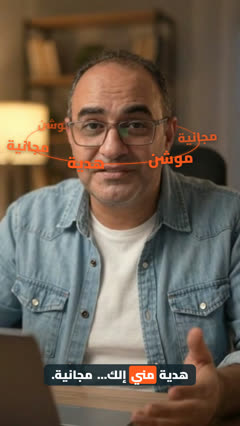 | **حلقة مدار**<br><sub>`orbit-ring`</sub> | كلمات تدور حول راسك من قدّام ومن ورا | «خلّ كلمات «…» تدور حول راسي» |
|  | **عدسة تكبير**<br><sub>`zoom-callout`</sub> | دائرة على تفصيلة بالمقطع، خطين، وعدسة تطلع تكبّرها ويا عنوان | «كبّر «…» بعدسة واكتب «…»» |
|  | **مقطع فيديو**<br><sub>`video`</sub> | مقطعك كما هو، مع زوم أو كتم الصوت | «حط مقطعي هنا، وكتّم صوته» |

## الانتقالات — Transitions

| | المؤثر | شنو يسوي | قول لـ Claude |
|---|---|---|---|
| 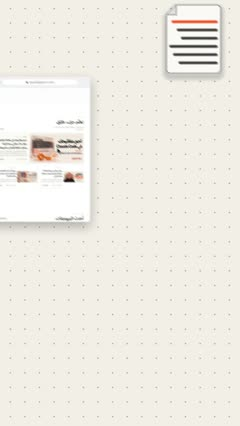 | **مساحة واحدة**<br><sub>`space-field`</sub> | كل الأفكار بمساحة وحدة: الكاميرا تطير من فكرة لفكرة وكل وحدة تبدأ حركتها لما توصل، وطبقات بارالاكس؛ أي مؤثر يصير محطة: عنوان، رسمة، موقع، جوال | «خلّ الفيديو مساحة وحدة والكاميرا تتنقّل بين الأفكار» |
| 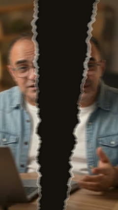 | **تمزيق ورق**<br><sub>`transition:paper-tear`</sub> | اللقطة نفسها تتمزّق بحواف ورق حقيقية | «انتقل بتمزيق ورق» |
| 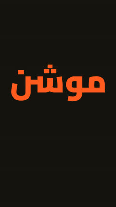 | **قلب صفحة**<br><sub>`transition:page-turn`</sub> | صفحة تنقلب مثل كتاب عربي | «انتقل بقلب صفحة» |
|  | **قصّ بالشفرة**<br><sub>`transition:blade-slice`</sub> | شفرة تقصّ المشهد ونصّه يزحلق | «انتقل بقصّة شفرة» |
|  | **ستائر**<br><sub>`transition:blinds`</sub> | شرائح تنفتح من اليمين | «انتقل بستائر» |
|  | **لوح حبر**<br><sub>`transition:ink-slab`</sub> | لوح غامق بحافة ملوّنة يمسح الشاشة | «انتقل بلوح حبر» |
|  | **ستارة بكسل**<br><sub>`transition:pixel-curtain`</sub> | مربعات تغطي وتكشف | «انتقل ببكسلات» |
|  | **نقاط القلم**<br><sub>`transition:pen-dot-curtain`</sub> | قطرة حبر وبعدين معيّنات تغطي | «انتقل بنقاط القلم» |
| 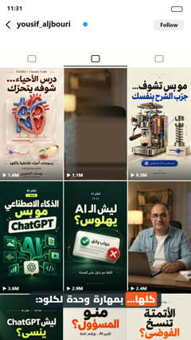 | **شبكة البروفايل**<br><sub>`transition:profile-grid`</sub> | المشهد يصير مربع بشبكة حسابك ويدخل بالثاني | «انتقل بشبكة بروفايلي (وأرسل صور منشوراتك)» |
|  | **انفجار ألواح**<br><sub>`transition:layer-explode`</sub> | المشهد يميل لوح زجاج ويطلع الثاني | «انتقل بانفجار ألواح» |
|  | **دائرة**<br><sub>`transition:iris`</sub> | دائرة تفتح أو تسكّر | «انتقل بدائرة» |
|  | **مسحة لون**<br><sub>`transition:color-wipe`</sub> | لون يمسح الشاشة | «انتقل بمسحة لون» |
|  | **سحبة سريعة**<br><sub>`transition:whip-pan`</sub> | الكاميرا تنسحب بسرعة للمشهد الثاني | «انتقل بسحبة سريعة» |
|  | **زوم عبر**<br><sub>`transition:zoom-through`</sub> | زوم داخل المشهد للثاني | «انتقل بزوم داخل» |
|  | **قطع جلتش**<br><sub>`transition:glitch-cut`</sub> | قطع بتشويش رقمي | «انتقل بجلتش» |
|  | **تحوّل**<br><sub>`transition:morph`</sub> | عنصر من المشهد يطير ويصير جزء من الثاني | «خلّ «…» يتحوّل للمشهد الجاي» |
|  | **فيضان لون**<br><sub>`transition:flood`</sub> | لون يفيض من نقطة ويغطي | «انتقل بفيضان لون» |
|  | **كشف**<br><sub>`transition:reveal`</sub> | العالم الجديد ينكشف تحت القديم | «اكشف المشهد الجاي من تحت» |

## أشياء ورسومات — Objects & diagrams

| | المؤثر | شنو يسوي | قول لـ Claude |
|---|---|---|---|
| 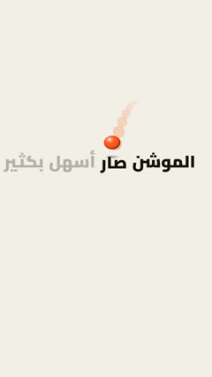 | **كرة تنط**<br><sub>`bounce-ball`</sub> | كرة بفيزياء حقيقية تنط من كلمة لكلمة ويا الكلام، تنضغط بكل نطّة وظلها يكبر، أو تطيح على شي وتهدى بنطّات تقل | «خلّ كرة تنط على كلمات «…» وحدة وحدة» |
| 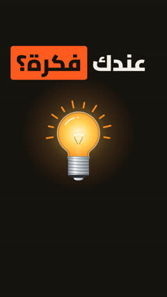 | **شي يتحوّل**<br><sub>`morph-object`</sub> | رسومات (مصباح، ملف، بيت، عملة…) تتحوّل لبعض | «ارسم مصباح ويتحوّل لـ «…»» |
|  | **رسم خطّي**<br><sub>`line-art`</sub> | رسمة خطوط بسيطة لفكرة | «ارسم «…» بخطوط بسيطة» |
|  | **أيقونة**<br><sub>`icon`</sub> | أيقونة وعنوانها | «حط أيقونة «…»» |
| 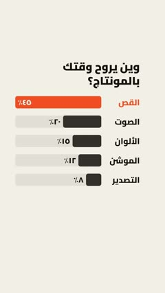 | **أشرطة أرقام**<br><sub>`stat-bars`</sub> | أشرطة تكبر وحدة وحدة والأرقام تعدّ، وشريط بطل باللون | «سوّ أشرطة: «…» ٤٥٪، «…» ٢٠٪، والأول بطل» |
| 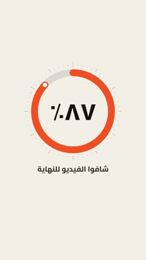 | **عدّاد دائري**<br><sub>`gauge-ring`</sub> | حلقة تمتلي لحد النسبة والرقم يعدّ بالنص | «سوّ عدّاد دائري يوصل ٨٧٪ «…»» |
| 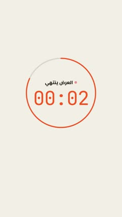 | **مؤقّت حي**<br><sub>`live-timer`</sub> | ساعة إيقاف أو عدّ تنازلي بنقطة تنبض وحلقة تقدّم | «سوّ عدّ تنازلي من ١٠ ثواني «…»» |
| 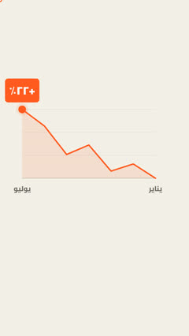 | **رسم بياني بالنقطة**<br><sub>`spring-graph`</sub> | نقطة برتقالية تنط من نقطة لنقطة وترسم الخط وراها، وبالنهاية تطلع «+٢٢٪» | «خلّ نقطة ترسم نمو «…» من «…» لـ «…»» |
| 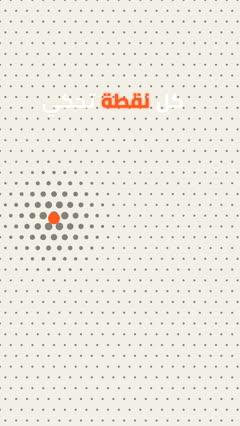 | **حقل النقاط**<br><sub>`halftone-field`</sub> | شبكة نقاط تكبر حوالين نقطة تتحرك، ومسحة نقاط تغطي الشاشة وتفتح على المشهد الجاي | «سوّ خلفية نقاط تتفاعل ويا النقطة، وانتقل بمسحة نقاط» |
| 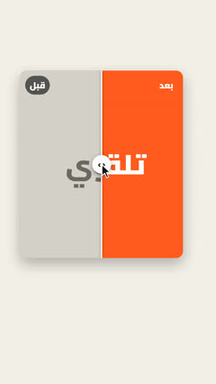 | **قبل وبعد**<br><sub>`before-after`</sub> | حالتين بلوحة وحدة؛ يد تسحب الفاصل والحالة الجديدة تدخل من اليمين (صور، أو كلمتين) | «وريني «…» قبل و«…» بعد بفاصل يتسحب» |
| 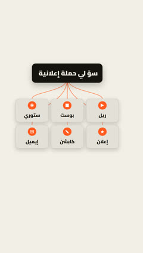 | **وحدة تصير كثير**<br><sub>`fan-cards`</sub> | كرت طلب واحد تطلع منه كروت نتائج كثيرة بخطوط مرسومة | «خلّ «…» يطلع منه «…» و«…» و«…»» |
| 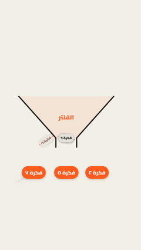 | **القمع**<br><sub>`funnel`</sub> | أفكار كثيرة تنزل بالقمع؛ المختارة تعدّي وتصطف، والباقي ينشطب ويطيح | «سوّ قمع يفلتر «…» ويطلع «…»» |
|  | **عدّاد**<br><sub>`counter`</sub> | رقم يعدّ لحد قيمة | «خلّ الرقم يعدّ لـ «…»» |
|  | **رقم يتبني**<br><sub>`build-number`</sub> | أشياء تنزل وتبني رقم | «ابني الرقم «…» من قطع» |
|  | **خانات مرقّمة**<br><sub>`numbered-slots`</sub> | كروت مرقّمة من اليمين | «سوّ ٣ خانات مرقّمة» |
| 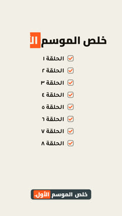 | **قائمة تتعلّم**<br><sub>`checklist`</sub> | بنود تنعلّم ✓ وحدة وحدة | «سوّ قائمة تتعلّم: «…»» |
|  | **مخطط سير عمل**<br><sub>`node-graph`</sub> | صناديق متصلة مثل n8n | «ارسم سير العمل: «…» ← «…»» |
|  | **طبقات متكدّسة**<br><sub>`layer-stack`</sub> | ألواح فوق بعض لشرح نظام | «وريني الطبقات: «…»» |
|  | **نبض**<br><sub>`ecg-line`</sub> | خط نبض والكلمات على الضربات | «سوّ خط نبض والكلمات عليه» |
|  | **شكل يتنقّل**<br><sub>`shape-states`</sub> | شكل واحد يتحوّل زر، كرت، نافذة | «خلّ الزر يتحوّل لنافذة» |
|  | **كتاب يتقلّب**<br><sub>`book-flip`</sub> | كتاب مفتوح صفحاته تتقلّب | «قلّب صفحات كتاب» |
|  | **مطاردة**<br><sub>`chase`</sub> | أشخاص صغار يركضون ورا شي | «خلّ الزبائن يركضون ورا «…»» |
|  | **عدسة**<br><sub>`microscope`</sub> | عدسة تكبّر جزء والباقي يغمق | «كبّر «…» بعدسة» |
|  | **إطار كاميرا**<br><sub>`viewfinder`</sub> | زوايا REC تتسكّر على المشهد | «حط إطار كاميرا يسجّل» |
|  | **العنصر البطل**<br><sub>`hero`</sub> | نقطة أو كرة تتنقّل بين المشاهد | «خلّ نقطة وحدة تمشي ويا الفيديو كله» |
|  | **صف شعارات**<br><sub>`logo-row`</sub> | شعارات تطلع وحدة وحدة | «حط شعارات «…»» |

## شاشات وواجهات — Screens & apps

| | المؤثر | شنو يسوي | قول لـ Claude |
|---|---|---|---|
|  | **شاشة Claude Code**<br><sub>`code-chat`</sub> | محادثة ذكاء اصطناعي كشاشة برمجة | «وريني المحادثة بشاشة Claude Code» |
|  | **نافذة الموافقة**<br><sub>`permission-prompt`</sub> | Claude يطلب موافقة وتنختار «لا تسألني مرة ثانية» | «وريني نافذة موافقة Claude» |
|  | **ملف كود**<br><sub>`code-file`</sub> | محرّر أسطره تنكتب، والسر يتوهّج أحمر | «وريني ملف «…» والسطر الخطر» |
|  | **شاشة موقع**<br><sub>`screen-mockup`</sub> | لقطة موقع حقيقية بمتصفح: الصفحة تنزل، إضاءة على جزء وزوم عليه، والماوس يضغط | «حط موقع «…» بمتصفح، انزل للـ «…» وسلّط عليه» |
|  | **شاشة جوال**<br><sub>`screen-mockup:phone`</sub> | لقطة تطبيق أو موقع بجوال: إصبع يضغط، الصفحة تنزل، وإضاءة على جزء | «حط «…» على جوال واضغط على «…»» |
|  | **واجهة تتحوّل**<br><sub>`ui-morph`</sub> | شكل واحد يصير زر، تحميل، صح، مفتاح، شريط، تبويبات، رسم بياني، إشعار، وجزيرة الجوال؛ والماوس يضغط كل مرة | «خلّ زر «…» يتحوّل لتحميل وبعدين صح وإشعار» |
|  | **نافذة تطبيق**<br><sub>`app-window`</sub> | نافذة تطبيق أو طرفية فيها أسطر | «حط نافذة طرفية تكتب «…»» |
|  | **تسجيل شاشة**<br><sub>`screen-clip`</sub> | تسجيل شاشتك داخل نافذة متصفح | «حط تسجيل الشاشة بنافذة» |
|  | **بحث يتكتب**<br><sub>`search-typing`</sub> | شريط بحث يكتب | «خلّ البحث يكتب «…»» |
|  | **زاحف البحث**<br><sub>`web-crawl`</sub> | نتائج بحث وروبوت يختار صفحة | «وريني البحث والروبوت يختار صفحة» |
|  | **جوال**<br><sub>`phone`</sub> | جوال بشاشة صورة أو رسائل | «حط «…» على شاشة جوال» |
|  | **إشعارات الجوال**<br><sub>`notify-stack`</sub> | إشعارات تنزل من فوق وتتكدّس: واتساب، إنستغرام، البنك… | «نزّل إشعارات: «…»، «…»، «…»» |
|  | **محادثة واتساب**<br><sub>`chat-thread`</sub> | محادثة رسائل حجز | «سوّ محادثة رسائل» |
|  | **كرت بروفايل**<br><sub>`profile-card`</sub> | كرت حساب بالأرقام | «حط كرت بروفايلي» |
|  | **كروت السكلز**<br><sub>`skill-deck`</sub> | صندوق يوزّع كروت على Claude Code وCursor | «وزّع السكلز على الأدوات» |
|  | **جهازين متطابقين**<br><sub>`twin-sync`</sub> | جهازك وجهاز صديقك بنفس النسخ وملف قفل | «وريني جهازي وجهاز صديقي متطابقين» |

## شرح الذكاء الاصطناعي — AI explainers

| | المؤثر | شنو يسوي | قول لـ Claude |
|---|---|---|---|
|  | **تاريخ توقّف المعرفة**<br><sub>`knowledge-timeline`</sub> | خط زمني يتعلّم لحد تاريخ وبعده ضباب | «اشرح تاريخ توقّف المعرفة» |
|  | **ملخص غلط**<br><sub>`misquote`</sub> | الصفحة تقول رقم والملخص يقول غيره | «وريني ملخص غلط لصفحة» |
|  | **نافذة السياق**<br><sub>`context-window`</sub> | كروت تتكسر توكنز وتملأ النافذة | «وريني نافذة السياق تمتلي» |
|  | **توكن ورا توكن**<br><sub>`token-stream`</sub> | الجواب ينبني قطعة قطعة | «وريني الجواب ينكتب توكن ورا توكن» |
|  | **نسب الكلمة الجاية**<br><sub>`token-odds`</sub> | أشرطة نسب، وشريط temperature يغيّرها | «وريني نسب الكلمة الجاية وtemperature» |
|  | **زار مغشوش**<br><sub>`loaded-die`</sub> | زار ثلاثي بوجوه كلمات | «اشرح العشوائية بزار مغشوش» |
|  | **السيرفر بنفس اللحظة**<br><sub>`server-batch`</sub> | أسئلة كثيرة تدخل السيرفر وكلمة بجوابك تتغيّر | «وريني السيرفر يحسب أسئلة كثيرة» |

## عناصر الكرييتر والختام — Creator elements & endings

| | المؤثر | شنو يسوي | قول لـ Claude |
|---|---|---|---|
|  | **قائمة المؤثرات**<br><sub>`effect-list`</sub> | لوحة «بهذا الفيديو» تتعلّم | «حط قائمة المؤثرات بالزاوية» |
|  | **مؤشّر حي**<br><sub>`live-cursor`</sub> | سهم ماوس يتحرك ويختار | «خلّ المؤشر يضغط على «…»» |
|  | **رسالة صوتية**<br><sub>`voice-note`</sub> | فقاعة رسالة صوتية تشتغل | «حط رسالة صوتية» |
|  | **تعليقات تنزل**<br><sub>`comment-drop`</sub> | إشعارات تعليقات تنزل وحدة وحدة | «نزّل تعليقات: «…»» |
|  | **ملصقات الأسئلة**<br><sub>`comment-stickers`</sub> | تعليقات المتابعين كملصقات مائلة | «حط أسئلة المتابعين كملصقات» |
|  | **ملصقات فوق الراس**<br><sub>`head-stack`</sub> | تاغات تتكدّس فوق نقطة | «كدّس كلمات «…» فوق راسي» |
|  | **كيبورد عربي**<br><sub>`predict-keys`</sub> | كيبورد يكتب ويقترح كلمات | «خلّ الكيبورد يكتب «…»» |
|  | **قرص الأيام**<br><sub>`day-dial`</sub> | قرص يدور ويوقف على اليوم | «دوّر القرص على «…»» |
|  | **جدار المنشورات**<br><sub>`post-wall`</sub> | منشورات تملأ الشاشة وعدّاد | «سوّ جدار منشورات وعداد «…»» |
|  | **ستايل صورة**<br><sub>`photo-look`</sub> | صورتك بجريدة قديمة، صحيفة، ورقة نقدية، أو إمباكت | «حط صورتي بجريدة قديمة» |
|  | **زر «علّق»**<br><sub>`comment-cta`</sub> | خانة تعليق تكتب كلمتك | «خلّ الختام «علّق: …»» |
|  | **بطاقة التوقيع**<br><sub>`signature-card`</sub> | اسمك وصورتك وروابطك بالنهاية | «اختم ببطاقتي» |

## أساسيات — Basics

| | المؤثر | شنو يسوي | قول لـ Claude |
|---|---|---|---|
|  | **خلفية**<br><sub>`backdrop`</sub> | خلفية ورقية فاتحة أو داكنة | «خلّ الخلفية داكنة» |
|  | **ترجمة**<br><sub>`captions`</sub> | ترجمة كلامك والكلمة المنطوقة ملوّنة | «حط ترجمة على كلامي» |
|  | **شريط الأقسام**<br><sub>`chapter-bar`</sub> | شرطات أعلى الشاشة لكل بند | «حط شريط أقسام فوق» |
|  | **شريط علوي**<br><sub>`hud`</sub> | معلومة ثابتة أعلى الشاشة | «حط «…» ثابت فوق» |

---

المجموع: 131 مؤثر وانتقال، و4 ستايلات. «…» = كلمتك أنت.

</div>
