# موشن بالعربي · Creator Studio

**اكتب نصّك، أو أرسل تعليقك الصوتي، أو صوّر نفسك — وClaude يطلّع لك ريل موشن عربي احترافي.**
حروف ما تتكسّر، كشيدة تتمدّد، اتجاه من اليمين لليسار، و٦٠ إطار بالثانية. هدية مجانية من يوسف الجبوري.

*Write a script, send a voice-over, or film yourself — Claude turns it into a professional Arabic
motion-graphics reel. Arabic-first, 60 fps, vertical. A free gift by Yousif Al Jbouri.*

<p align="center">
  
</p>
<p align="center"><sub>شبكة زوم · تركيز خلفي · غوص خلف الحروف · نسخ متكررة · حلقة مدار · جسم من الكود · زوم دوللي · يتطاير · شبكة البروفايل</sub></p>

---

## وش يقدر يسوي — What it can do

<table>
  <tr>
    <td align="center" width="33%">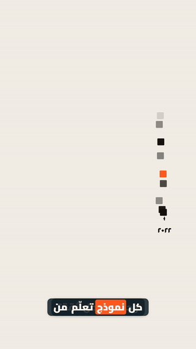<br><b>شروحات تعليمية</b><br><sub>Explainer heroes: a knowledge timeline, the cutoff, the fog</sub></td>
    <td align="center" width="33%">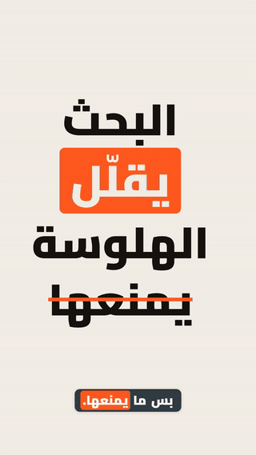<br><b>بحث، مصدر ضعيف، نافذة سياق</b><br><sub>Search crawler, a wrong summary, tokens filling the context</sub></td>
    <td align="center" width="33%">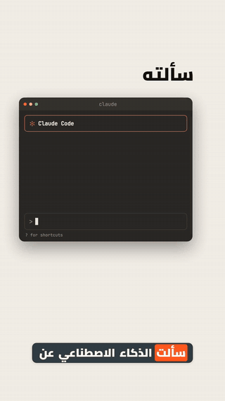<br><b>شاشة Claude Code</b><br><sub>AI chats as a real coding-assistant screen</sub></td>
  </tr>
  <tr>
    <td align="center">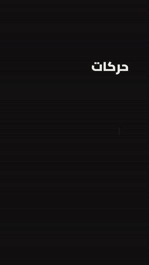<br><b>تجميع الخط وتمدّد الكشيدة</b><br><sub>Letters fly together into the word; the kashida stretches with a ruler</sub></td>
    <td align="center">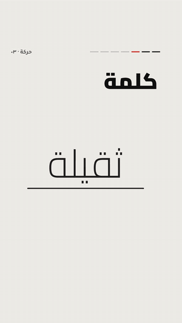<br><b>حيل الخط</b><br><sub>A heavy word, said vs written, a cut on the word, a strike, a stamp</sub></td>
    <td align="center">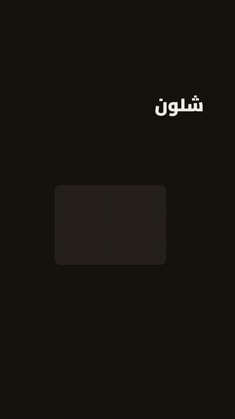<br><b>أشكال تتحوّل</b><br><sub>Drawn objects morphing one into the next</sub></td>
  </tr>
  <tr>
    <td align="center">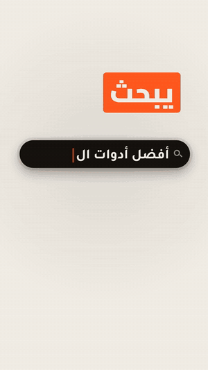<br><b>شرح الأنظمة</b><br><sub>Search typing, a workflow graph, a layer stack</sub></td>
    <td align="center">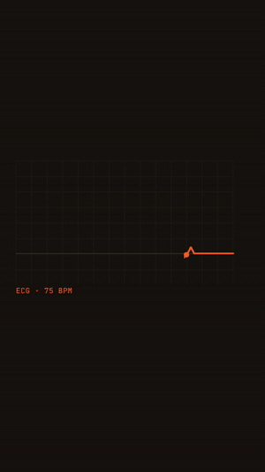<br><b>نبض وتحوّل</b><br><sub>A heartbeat line with words on the beats, an idea becoming a result</sub></td>
    <td align="center">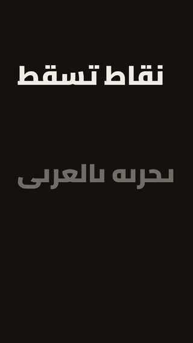<br><b>حركات الخط العربي</b><br><sub>Nine Arabic headline moves — letters never break</sub></td>
  </tr>
  <tr>
    <td align="center"><br><b>انتقالات وموشن بلر</b><br><sub>Page turn, paper tear, ink slab, blinds… with motion blur</sub></td>
    <td align="center">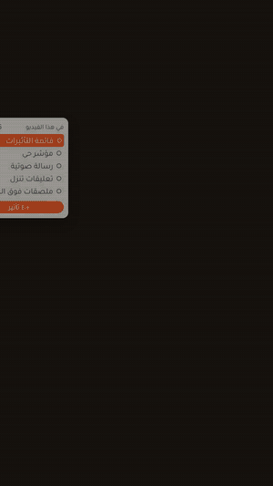<br><b>عناصر الكرييتر</b><br><sub>Effect list, live cursor, voice note, comments, Arabic keyboard, dial, post wall</sub></td>
    <td align="center">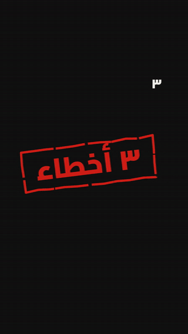<br><b>من نص على إيقاع</b><br><sub>A list reel from a script, no voice — made by Claude with the skill alone</sub></td>
  </tr>
  <tr>
    <td colspan="3">

**بداخلها — Inside**
- **٨ قوالب جاهزة:** قائمة، مشكلة وحل، خطوات، سألتوني، أداة، دليل حلقي، شرح نظام، تشويقة.
- **مؤثرات على شخصك:** قصّ الشخص من الفيديو تلقائياً، ثم شبكة زوم، تركيز خلفي، غوص في الحروف، نسخ، مدار، كود، زوم دوللي، تطاير.
- **أدوات الشرح:** خط زمني للمعرفة، شاشة Claude Code، زاحف بحث، ملخص غلط، نافذة سياق.
- **ترجمة تلقائية** على صوتك بكلمات النص، و**بطاقة نهاية** باسمك وروابطك.
- **ستوري بورد أولاً:** صور للموافقة قبل أي رندر — ٦٠ إطار، عمودي ٩:١٦.
- **ستايل الليزر السينمائي:** عنوان يتقصّ بالليزر، كلمات تتوهّج، أشعة ومخططات، ضربات على الإيقاع.

👈 **[كتالوج المؤثرات كامل بالصور — Effects catalog](EFFECTS.md)**: أكثر من ١٠٠ مؤثر وانتقال، كل واحد باسمه والجملة اللي تقولها لـ Claude.

</td>
  </tr>
</table>

## كيف يشتغل — How it works
1. **قل لـ Claude وش تبي:** «سوّ لي ريل موشن بالعربي عن…» — مع نصّك، أو صوتك، أو مقطعك.
2. **يختار القالب** ويطلّع لك **صور الستوري بورد** — لحظة من كل جملة.
3. **توافق أو تعطي ملاحظات** — ما يرندر شي قبل موافقتك.
4. **يرندر الفيديو** ٦٠ إطار بالثانية، جاهز للنشر.

كل خطوة تحت مكتوبة بطريقتين: **أمر للطرفية**، أو **جملة تلصقها في تطبيق Claude (تبويب Code)** إذا ما تحب
الطرفية. Every step below comes two ways: a terminal command, or a sentence to paste into the Claude app's
Code tab.

---

## ١ · المتطلبات — Requirements
- Windows 10/11 أو macOS، وحوالي ٣ غيغا مساحة.
- **مطلوب:** Node.js 20+، ffmpeg، متصفح Chromium للرندر (يتنزّل بخطوة ٣).
- **اختياري:** whisper.cpp لتفريغ صوتك (التوقيت على كلامك)، وPython + mediapipe لقصّ الشخص من الفيديو.

## ٢ · نزّل الملفات — Get the files
ضع المجلد في مجلد المستخدم باسم `motion-bilarabi` (المهارة تدوّر عليه هناك).

```bash
git clone https://github.com/joe7182/motion-bilarabi-skill.git ~/motion-bilarabi
```
أو في Claude: «نزّل مستودع github.com/joe7182/motion-bilarabi-skill إلى مجلد motion-bilarabi في مجلد المستخدم»

## ٣ · ثبّت الأدوات — Install the tools
**Windows**
```bash
winget install OpenJS.NodeJS.LTS
```
```bash
winget install Gyan.FFmpeg
```
**macOS**
```bash
brew install node ffmpeg
```
ثم داخل مجلد المحرّك — then inside the engine folder:
```bash
cd ~/motion-bilarabi/engine && npm install && npx playwright install chromium
```
أو في Claude: «ثبّت لي Node.js وffmpeg، وبعدها شغّل npm install وnpx playwright install chromium في مجلد ~/motion-bilarabi/engine»

## ٤ · ركّب المهارة في Claude — Install the skill
**Windows (PowerShell)**
```bash
Copy-Item -Recurse "$HOME\motion-bilarabi\skill\motion-bilarabi" "$HOME\.claude\skills\motion-bilarabi"
```
**macOS**
```bash
mkdir -p ~/.claude/skills && cp -r ~/motion-bilarabi/skill/motion-bilarabi ~/.claude/skills/
```
أو في Claude: «انسخ مجلد skill/motion-bilarabi من ~/motion-bilarabi إلى ~/.claude/skills»

## ٥ · هويتك — Your brand
انسخ `engine/examples/brand.json` إلى `~/.mba/brand.json` وعدّله: اسمك، حسابك، ألوانك، صورتك، روابطك،
وكلمة التعليق. منها تنبني بطاقة النهاية وزر «علّق».

| الحقل | معناه |
|---|---|
| `name` · `nameEn` | اسمك بالعربي وبالحروف اللاتينية |
| `tagline` · `taglineAccent` | جملتك تحت الاسم (الجزء الثاني باللون المميّز) |
| `colors` | `primary` (اللون المميّز)، `bg`، `text` |
| `avatar` | مسار صورتك |
| `links` | `instagram`، `youtube`، `tiktok`، `site` (اكتب @الحساب أو الرابط) |
| `keyword` | الكلمة اللي يكتبها المتابع بالتعليق |

أو في Claude: «سوّ لي ملف الهوية ~/.mba/brand.json باسمي وحسابي ولوني وصورتي وروابطي»

## ٦ · اختياري: تفريغ صوتك — Optional: voice timing
نزّل whisper.cpp (Windows: `whisper-bin-x64.zip` من صفحة الإصدارات في github.com/ggml-org/whisper.cpp،
macOS: `brew install whisper-cpp`) والنموذج `ggml-large-v3-turbo-q5_0.bin` إلى `~/.mba/models`.

أو في Claude: «ثبّت لي whisper.cpp ونموذج large-v3-turbo في ~/.mba/models»

## ٧ · اختياري: قصّ الشخص من الفيديو — Optional: person cut-out
```bash
pip install mediapipe opencv-python
```
```bash
curl -L --create-dirs -o ~/.mba/models/selfie_segmenter.tflite https://storage.googleapis.com/mediapipe-models/image_segmenter/selfie_segmenter/float16/latest/selfie_segmenter.tflite
```
أو في Claude: «ثبّت لي mediapipe وopencv-python بـ pip، ونزّل نموذج selfie_segmenter.tflite إلى ~/.mba/models»

**للقناع الاحترافي (شعر وحواف ناعمة):** نموذج MODNet ‏(Apache-2.0، ‏٢٦ ميغا) — With MODNet the cut-out keeps real hair strands:
```bash
pip install onnxruntime
```
```bash
curl -L --create-dirs -o ~/.mba/models/modnet.onnx https://huggingface.co/Xenova/modnet/resolve/main/onnx/model.onnx
```
أو في Claude: «ثبّت لي onnxruntime بـ pip، ونزّل نموذج MODNet ‏(model.onnx من huggingface.co/Xenova/modnet) باسم modnet.onnx إلى ~/.mba/models»

صوّر بدقة 1080p أو أعلى: كل ما زادت الدقة، طلع القصّ أنظف — Film at 1080p or higher: the sharper the clip, the cleaner the cut.

**اختياري — خلفية المكان فاضي (Clean plate):** قبل أو بعد التصوير، صوّر المكان بدونك من نفس مكان الكاميرا
(صورة أو ثانيتين فيديو). المؤثرات اللي تشيلك من المشهد (التطاير، النسخ، الزوم الدوللي، التركيز الخلفي)
تكشف الخلفية الحقيقية بدل ما يتخيّلها المحرّك — Optional: a photo of the empty scene from the same spot makes
every effect that removes you show the real room.
```bash
npx tsx src/cli.ts plate <project> m1 empty-room.jpg
```
أو في Claude: «هذي صورة المكان فاضي، استخدمها كخلفية للقناع»

## ٨ · افحص التجهيز — Check
```bash
cd ~/motion-bilarabi/engine && npx tsx src/cli.ts doctor
```
أو في Claude: «شغّل mba doctor من مهارة موشن بالعربي وصلّح الناقص»

لازم يطلع «جاهز تصنع فيديو ✓». أي شي ناقص، الفحص يكتب لك طريقة الإصلاح بالطريقتين.

## ٩ · أول فيديو — Your first video
افتح Claude واكتب مثلاً:
> «سوّ لي ريل موشن بالعربي عن ٣ أخطاء بالمونتاج» — وأرفق تعليقك الصوتي (أو بدونه، على إيقاع).

Claude يسألك عن **الستايل** (كريمي، داكن، ليزر، سويسري) والحركة (ناعمة أو حادة)، يختار القالب، يطلع لك **صور الستوري بورد** أول، وما يرندر إلا بعد موافقتك.

تبي مؤثر معيّن لجملة؟ اكتبه بالاسم من [الكتالوج](EFFECTS.md):
> «الجملة ٢: شطب الكلمة على «الخط» · بين القسم ١ و٢: تمزيق ورق · الختام: بطاقة التوقيع»

---

## ١٠ · جرّب الآن — Try it now
`engine/examples/try-it/`: فيديو تجريبي ٣١ ثانية على مقطعك أنت (تتكلم أمام الكاميرا)، فيه شبكة الزوم،
التركيز الخلفي، الغوص في الحروف، النسخ، المدار، جسم الكود، الزوم، التطاير، وانتقال شبكة البروفايل.
A 31-second demo of the video effects on your own talking clip — see its README.

---

## الترخيص — Licence
MIT © Yousif Aljbouri · يوسف الجبوري. Third-party licences: `THIRD_PARTY.md`.
